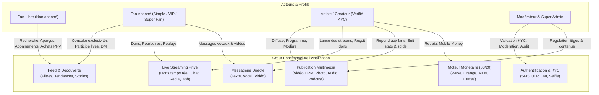
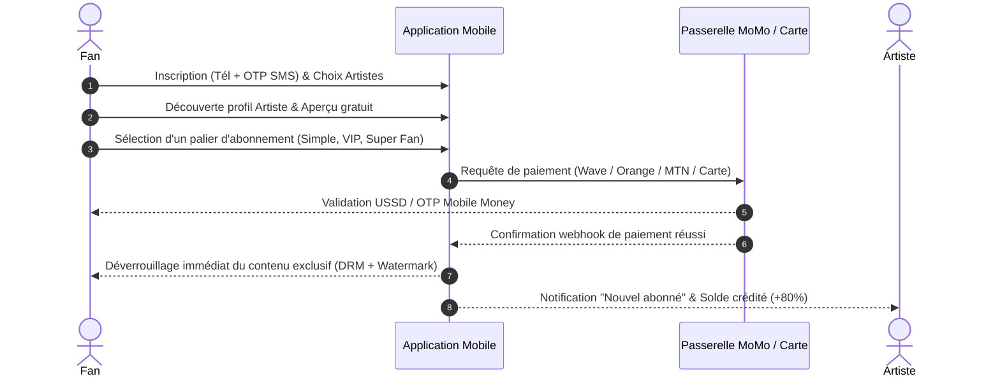
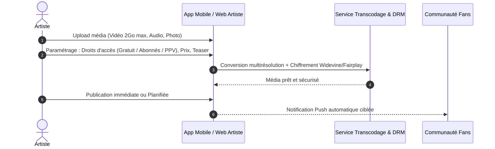
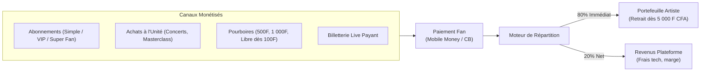
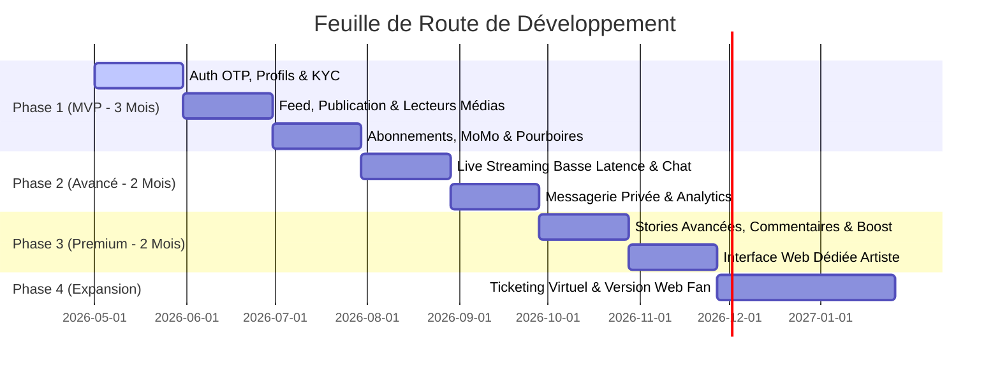

# 🗺️ Cartographie Complète des Fonctionnalités & Actions de la Plateforme
> **Document de synthèse opérationnelle & fonctionnelle**  
> Basé sur le *Cahier des charges — Application Mobile Artistes & Fans (v2.0)*

---

## 📌 1. Vue d'Ensemble & Architecture Fonctionnelle

La plateforme est une application mobile (iOS & Android) dédiée aux créateurs et artistes africains, articulée autour de 4 piliers majeurs : **Découverte**, **Consommation de contenus exclusifs**, **Interaction directe (Live & Chat)**, et **Monétisation via Mobile Money & Cartes bancaires**.

---

## 👥 2. Matrice des Rôles & Capacités d'Action

| Domaine d'Action | Fan Non Abonné (Libre) | Fan Simple (5 000 F) | Fan VIP (10 000 F) | Super Fan (25 000 F) | Artiste Vérifié | Super Admin / Modérateur |
| :--- | :---: | :---: | :---: | :---: | :---: | :---: |
| **Création de compte / Profil** | ✅ | ✅ | ✅ | ✅ | ✅ (KYC Requis) | ✅ |
| **Explorer le Feed & Découverte** | ✅ (Aperçus bridés) | ✅ | ✅ | ✅ | ✅ | ✅ |
| **Consommer Médias Exclusifs** | ❌ (Cadenas) | ✅ (Inclus) | ✅ (Inclus) | ✅ (Inclus) | ❌ (Sur ses pairs) | ✅ (Modération) |
| **Acheter Contenu à l'Unité (PPV)** | ✅ (Plein tarif) | ✅ | ✅ (-10% remise) | ✅ (-10% remise) | — | ✅ |
| **Envoyer Pourboires (Tips)** | ✅ | ✅ | ✅ | ✅ | ❌ (Reçoit 80%) | — |
| **Accéder aux Lives Abonnés** | ❌ (Sauf ticket PPV) | ✅ | ✅ | ✅ | Diffuseur | ✅ (Supervision) |
| **Replay des Lives (48h)** | ❌ | ❌ | ✅ | ✅ | ✅ (Illimité) | ✅ |
| **Messagerie Directe (DM)** | ❌ | ⚠️ Texte (si activé) | ✅ Texte + Vocal | ✅ Texte + Vocal + Vidéo | ✅ Boîte complète | 👁️ Lecture litiges |
| **Publication de Contenus** | ❌ | ❌ | ❌ | ❌ | ✅ | ❌ (Gestion/Suppr) |
| **Tableau de Bord / Analytics** | ❌ | ❌ | ❌ | ❌ | ✅ (Revenus, MRR, Vues) | ✅ (Global) |
| **Retraits Financiers (Payouts)** | ❌ | ❌ | ❌ | ❌ | ✅ (MoMo dès 5 000 F) | ✅ (Approbation) |

---

## 📱 3. Répertoire des Écrans et Actions par Parcours

### 3.1. Parcours Fan (Consommateur & Soutien)

#### Écrans Fan & Actions Clés :
1. **Écran d'Accueil / Feed (`SCR-FAN-01`)**
   - *Actions* : Scroller les posts des artistes suivis, lancer une story (haut de page), cliquer sur un badge "EN DIRECT", liker/commenter.
2. **Page Découverte & Recherche (`SCR-FAN-02`)**
   - *Actions* : Rechercher par nom / hashtag, filtrer par pays / catégorie (Musique, Comédie, etc.), consulter le top tendances.
3. **Profil Artiste Public (`SCR-FAN-03`)**
   - *Actions* : Consulter bio, stats et liens sociaux ; visionner aperçus gratuits ; déclencher un abonnement ou un don.
4. **Lecteurs Médias Sécurisés (`SCR-FAN-04-06`)**
   - *Vidéo (`SCR-FAN-04`)* : Plein écran, sélection qualité (1080p, 720p, 480p), watermark anti-fuite.
   - *Audio/Musique (`SCR-FAN-05`)* : Lecteur mini/maxi avec cover, lecture en tâche de fond.
   - *Galerie Photos (`SCR-FAN-06`)* : Swipe carrousel jusqu'à 10 photos HD protégées.
5. **Espace Live Streaming (`SCR-FAN-07`)**
   - *Actions* : Visualiser le flux vidéo basse latence, envoyer un message dans le chat, envoyer un pourboire animé (3 sec à l'écran), réagir (cœur, feu).
6. **Messagerie Privée (`SCR-FAN-08`)**
   - *Actions* : Envoyer message texte, note vocale (jusqu'à 2 min), ou vidéo courte (30 sec) selon le palier souscrit.
7. **Mon Portefeuille & Abonnements (`SCR-FAN-09`)**
   - *Actions* : Gérer les renouvellements mensuels J+30, annuler un abonnement, consulter l'historique des achats PPV à vie.

---

### 3.2. Parcours Artiste (Créateur & Entrepreneur)

#### Écrans Artiste & Actions Clés :
1. **Tableau de Bord / Dashboard (`SCR-ART-01`)**
   - *Actions* : Vue en temps réel du revenu mensuel (MRR), solde disponible, courbe 12 mois, nombre d'abonnés par palier.
2. **Studio de Création / Publication (`SCR-ART-02`)**
   - *Actions* : Uploader fichiers volumineux (vidéo jusqu'à 2 Go, podcast jusqu'à 500 Mo), définir légende avec hashtags, fixer le statut de visibilité, attacher un extrait gratuit (teaser 30s).
3. **Régie Live (`SCR-ART-03`)**
   - *Actions* : Paramétrer le type d'accès (abonnés seuls ou ticket payant), tester caméra/micro, modérer le chat en direct (épingler, bannir, mode lent 5s/10s/30s), voir le total des dons cumulés en live.
4. **Gestion des Offres d'Abonnement (`SCR-ART-04`)**
   - *Actions* : Personnaliser les prix de ses 3 niveaux (Simple, VIP, Super Fan) entre 1 000 F et 100 000 F CFA.
5. **Portefeuille & Demande de Versement (`SCR-ART-05`)**
   - *Actions* : Consulter les 80% nets perçus, demander un virement instantané Mobile Money (Orange, Wave, MTN) dès 5 000 F CFA cumulés.
6. **Messagerie Prioritaire (`SCR-ART-06`)**
   - *Actions* : Filtrer les discussions par badge fan (Super Fan en tête), répondre par audio/vidéo personnalisée.

---

### 3.3. Parcours Administrateur & Modération

1. **Vérification KYC Artistes (`SCR-ADM-01`)** : Examen de la pièce d'identité + selfie anti-fraude, attribution du badge vérifié sous 48h.
2. **Console de Modération (`SCR-ADM-02`)** : Traitement des signalements utilisateurs sur commentaires ou médias, retrait de contenus non conformes avec notification à l'artiste.
3. **Surveillance Financière & Audit (`SCR-ADM-03`)** : Monitoring des commissions plateforme (20%), contrôle des taux d'échec Mobile Money et réconciliation bancaire.

---

## 💰 4. Modèle Économique & Moteur de Revenus

Tous les flux de monétisation suivent la règle standard **80% Artiste / 20% Plateforme**, sans frais cachés pour l'artiste.

---

## 🚀 5. Roadmap Produit & Phasage de Développement

Pour un pilotage agile et un time-to-market optimal, le déploiement est structuré en 4 phases :

### Détail des Livrables par Phase :

* **Phase 1 — MVP (Mois 1 à 3) : L'essentiel pour générer du revenu**
  - Authentification Fan & Artiste (OTP Twilio + KYC CNI/Selfie).
  - Profils publics & Grille de publications.
  - Moteur de lecture vidéo (transcodage 480p/720p/1080p, DRM Widevine/Fairplay) et audio.
  - Système d'abonnement récurrent à 3 paliers.
  - Paiements Mobile Money (Orange Money, MTN, Wave via Flutterwave/Paystack) et Cartes bancaires (Stripe).
  - Pourboires & Achats de contenus à l'unité (PPV).
  - Tableau de bord artiste basique (solde et versements MoMo).

* **Phase 2 — Avancé (Mois 4 à 5) : Rapprochement & Direct**
  - Live Streaming privé (AWS IVS / Agora) avec latence < 3 secondes.
  - Chat interactif en direct avec animations de dons et modération temps réel.
  - Replays automatiques archivés 48h pour les abonnés VIP/Super Fan.
  - Messagerie directe hiérarchisée (texte, vocaux, micro-vidéos).
  - Module Analytics approfondi (MRR, taux de rétention, taux de complétion vidéo).

* **Phase 3 — Premium (Mois 6 à 7) : Engagement & Confort Artiste**
  - Stories éphémères (24h) et système de commentaires imbriqués avec signalement.
  - Recherche avancée avec filtres multicritères (pays, style, trending).
  - Interface Web complète pour artistes (React / Vite) pour gestion bureautique confortable.

* **Phase 4 — Écosystème & Expansion (Continu) : Scalabilité régionale**
  - Billetterie virtuelle pour grands événements et concerts en direct.
  - Marketplace de merchandising et fonctionnalités web pour les fans.
  - Déploiement multi-pays pan-africain.

---

## 🔒 6. Règles Critiques de Sécurité & Anti-Piratage

| Risque | Solution Technique Déployée |
| :--- | :--- |
| **Fuite & Capture d'écran** | Activation de `FLAG_SECURE` sur Android (écran noir sur capture) et protection native AVPlayer / FairPlay sur iOS. |
| **Téléchargement illégal du flux vidéo** | Chiffrement DRM (Widevine Modular L1/L3 pour Android, FairPlay Streaming pour iOS) avec clés tournantes. |
| **Partage externe illicite** | **Watermarking dynamique invisible** intégrant le pseudo et l'ID du fan connecté directement incrustés sur les frames. |
| **Paiements frauduleux** | Authentification 3D-Secure sur cartes + signatures webhook cryptographiques HMAC-SHA256 pour les opérateurs MoMo. |

---

## 📋 7. Table des Références Automatiques du Système

| Domaine | Format de Clé Primaire | Exemple Réel |
| :--- | :--- | :--- |
| **Abonnement** | `SUB-[ART_ID]-[FAN_ID]-[AAAAMM]` | `SUB-A042-F189-202604` |
| **Publication** | `POST-[ART_ID]-[AAAAMMJJ]-[XXX]` | `POST-A042-20260415-007` |
| **Session Live** | `LIVE-[ART_ID]-[AAAAMMJJ]-[XXX]` | `LIVE-A042-20260415-001` |
| **Message Privé** | `MSG-[CONV_ID]-[XXXXX]` | `MSG-C0091-00234` |
| **Pourboire** | `TIP-[AAAAMM]-[XXXXX]` | `TIP-202604-00089` |
| **Contenu Payant (PPV)** | `ACHAT-[FAN_ID]-[POST_ID]-[AAAAMM]` | `ACHAT-F189-P031-202604` |
| **Versement Artiste** | `VERS-[ART_ID]-[AAAAMM]` | `VERS-A042-202604` |

