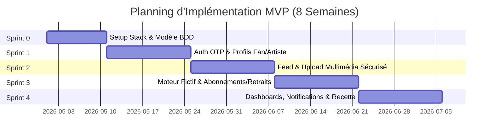

# 🚀 Plan d'Implémentation du MVP — Plateforme Artistes & Fans
> **Option Stratégique : Système de Paiements et de Retraits Fictifs (Mock Engine)**  
> **Cible :** Validation produit, tests UX et recette fonctionnelle complète sans dépendance aux agréments fintech/télécom.

---

## 🎯 1. Contexte & Enjeux du Choix "Paiements Fictifs"

L'intégration d'agrégateurs Mobile Money (Orange Money, MTN MoMo, Wave) et de cartes bancaires (Flutterwave, Stripe) impose généralement :
- Des démarches administratives et KYC d'entreprise longues (3 à 8 semaines).
- Des contraintes de comptes marchands par pays (UEMOA / CEMAC).
- Des risques de blocage lors des phases de tests fonctionnels et de soumission aux stores (App Store & Google Play).

**La solution retenue pour le MVP :**
Développer l'application avec un **Moteur de Paiement & Retrait Fictif ("Mock Payment & Payout Engine")**.
* Les écrans de paiement (sélection Orange, MTN, Wave, Carte) et les parcours sont **100% réalistes** pour l'utilisateur.
* La transaction est validée via une passerelle simulée (avec possibilité de tester les succès, échecs et délais).
* Les règles de gestion réelles s'exécutent fidèlement : déverrouillage des contenus, attribution du rôle abonné, calcul de la commission 80/20, alimentation du portefeuille artiste et simulation du virement vers le numéro Mobile Money.
* **Architecture Plug & Play :** Grâce au pattern *Adapter/Strategy*, le jour où les clés API Flutterwave/Wave/Stripe sont validées, une simple variable d'environnement permet de basculer vers les paiements réels, **sans toucher à la logique métier ni aux interfaces**.

---

## 🏗️ 2. Architecture Technique du Moteur Fictif

```mermaid
flowchart TD
    UI[Interface Utilisateur Mobile\nBouton S'abonner / Tip / Acheter PPV / Retrait] --> Service[Service Métier Commerce & Portefeuille]
    
    Service --> AdapterFactory{Variable d'environnement\nPAYMENT_PROVIDER}
    
    AdapterFactory -->|mock par défaut en MVP| MockEngine[Moteur Fictif\nMockPayment & PayoutService]
    AdapterFactory -->|futur live| RealGateway[Passerelle Réelle\nFlutterwave / Wave / Stripe]
    
    MockEngine --> ModalSimu[Bottom Sheet de Simulation\nSuccès immédiat | Échec solde | Timeout]
    ModalSimu --> EventSuccess[Événement Webhook Local TXN_SUCCESS]
    
    EventSuccess --> CoreLogic[Moteur Métier Principal]
    CoreLogic --> Unlock[Déverrouillage Médias / Droits VIP]
    CoreLogic --> Wallet[Calcul 80% Artiste / 20% Plateforme]
    CoreLogic --> Notif[Notification Push Fan & Artiste]
```

### 2.1. L'Interface Abstraite (Backend / Client)
```python
# Exemple de contrat d'interface découplé
class PaymentGatewayInterface(ABC):
    @abstractmethod
    async def initiate_payment(self, user_id: str, amount: float, currency: str, method: str, metadata: dict) -> PaymentResponse:
        pass

    @abstractmethod
    async def request_payout(self, artist_id: str, amount: float, momo_number: str, operator: str) -> PayoutResponse:
        pass
```

### 2.2. Le Composant Simulateur (UI & Comportement)
Quand un utilisateur clique sur **"Payer avec Orange Money (5 000 F)"** ou qu'un artiste clique sur **"Demander un retrait (15 000 F)"** :
1. Une feuille modale réaliste s'ouvre avec le logo de l'opérateur choisi et le récapitulatif.
2. Un sélecteur d'environnement de test propose :
   - ✅ **Simuler un paiement validé** (délai configurable : 1s à 3s pour simuler le push USSD).
   - ❌ **Simuler un échec / Solde insuffisant** (pour valider la gestion d'erreur).
   - ⏱️ **Simuler un timeout / Annulation**.
3. En cas de succès :
   - Enregistrement en base de données avec référence réelle (`TXN-202604-00001`, `SUB-A042-F189-202604`).
   - Déclenchement des accès et notification.

---

## 🗓️ 3. Feuille de Route d'Implémentation (Sprint par Sprint)

Le MVP est calibré sur **8 à 10 semaines** réparties en 5 sprints opérationnels de 2 semaines.



---

### 🔹 Sprint 0 (Semaines 1 & 2) : Fondations Techniques & Architecture
* **Objectif :** Initialiser les dépôts de code, la base de données et l'architecture logicielle.
* **Livrables :**
  1. **Stack Mobile :** Initialisation du projet **Flutter** (avec architecture Clean / BLoC ou Riverpod, support iOS et Android).
  2. **Stack Backend :** API **Python FastAPI** avec documentation OpenAPI/Swagger intégrée et conteneur Docker.
  3. **Base de données :** Schéma **PostgreSQL** (tables `users`, `profiles`, `subscriptions`, `posts`, `media`, `transactions`, `wallets`, `payouts`).
  4. **Stockage Médias :** Configuration du stockage objet (AWS S3 ou compatible local MinIO) avec URLs pré-signées.
  5. **Contrat d'API :** Définition des schémas JSON pour tous les endpoints.

---

### 🔹 Sprint 1 (Semaines 3 & 4) : Authentification, Onboarding & Gestion des Profils
* **Objectif :** Permettre aux fans et artistes de créer un compte et de configurer leur profil.
* **Livrables :**
  1. **Inscription Fan :** Téléphone / Email, mot de passe, pays. Vérification OTP SMS (simulable en mode test avec code universel `123456` ou via Twilio).
  2. **Inscription Artiste & KYC :**
     - Saisie nom de scène, bio, catégorie artistique.
     - Upload des documents KYC (CNI / Passeport + Selfie anti-fraude).
     - Dashboard d'approbation rapide pour l'administrateur (validation en 1 clic pour débloquer le statut créateur).
  3. **Page Profil Artiste :** Bannière, photo, bio, liens réseaux, badges de vérification.
  4. **Configuration des Offres d'Abonnement :** Formulaire artiste permettant de définir le prix de ses 3 paliers (*Simple*, *VIP*, *Super Fan*).

---

### 🔹 Sprint 2 (Semaines 5 & 6) : Publication de Contenus, Feed & Lecteurs Médias
* **Objectif :** Permettre la création et la consommation de médias riches avec restriction d'accès.
* **Livrables :**
  1. **Studio de Publication Artiste :**
     - Upload Vidéo (jusqu'à 2 Go), Musique/Audio (MP3), Album Photos (jusqu'à 10 photos), Podcasts.
     - Sélection du niveau de visibilité : *Public/Gratuit*, *Abonnés seulement*, *Payant à l'unité (PPV)*.
     - Paramétrage d'un teaser gratuit (extrait 30 secondes pour les vidéos payantes).
  2. **Lecteurs Médias Sécurisés :**
     - Lecteur Vidéo (support multi-qualités, verrouillage si non abonné, watermark superposé affichant l'identifiant du fan).
     - Lecteur Audio avec pochette et commandes de lecture.
     - Galerie photo plein écran avec protection contre les captures (`FLAG_SECURE`).
  3. **Feed d'Accueil & Découverte :**
     - Fil d'actualité chronologique des artistes suivis.
     - Affichage des cadenas visuels sur les contenus exclusifs non débloqués.
     - Recherche par nom, hashtag et filtre par pays/catégorie.

---

### 🔹 Sprint 3 (Semaines 7 & 8) : Moteur de Paiement & Retrait Fictif (Le Cœur Économique)
* **Objectif :** Rendre l'écosystème monétaire totalement fonctionnel et testable sans compte bancaire.
* **Livrables :**
  1. **Intégration du `MockPaymentGateway` :**
     - Parcours de souscription à un abonnement (Simple 5 000 F, VIP 10 000 F, Super Fan 25 000 F).
     - Parcours d'envoi de pourboires (500 F, 1 000 F, montant libre).
     - Parcours d'achat de contenu à l'unité (PPV).
     - Fenêtre modale de sélection de l'opérateur (Orange Money, MTN, Wave, Carte) avec trigger de simulation (Succès / Échec).
  2. **Exécution des Règles Métier Post-Paiement :**
     - Déverrouillage instantané du contenu acheté ou de l'accès aux posts abonnés.
     - Génération des références de transactions normées (`TXN-...`, `SUB-...`, `ACHAT-...`).
     - Attribution de la durée de validité (J+30 pour abonnement, permanent pour PPV).
  3. **Moteur de Portefeuille Artiste & Retrait Fictif :**
     - Répartition automatique : 80% crédités sur le solde disponible de l'artiste / 20% commission plateforme.
     - Interface de demande de versement (retrait Mobile Money dès 5 000 F CFA).
     - Simulation du cycle de vie du retrait : *Demandé* ➔ *En traitement* ➔ *Effectué*, avec débit du solde et historique complet (`VERS-...`).

---

### 🔹 Sprint 4 (Semaines 9 & 10) : Tableaux de Bord, Notifications & Recette UAT
* **Objectif :** Finaliser la boucle de valeur, auditer l'ensemble des parcours et préparer la démo.
* **Livrables :**
  1. **Tableau de Bord Artiste Complet :**
     - Revenu total du mois en cours, solde immédiatement retirable.
     - Graphique de répartition des revenus (Abonnements vs PPV vs Pourboires).
     - Liste des abonnés récents et métriques de vues de contenu.
  2. **Espace Personnel Fan :**
     - Onglet "Mes Abonnements" (statut, date de fin, bouton de résiliation).
     - Onglet "Mes Achats" (historique des vidéos/masterclass acquises à vie).
  3. **Système de Notifications :**
     - Alertes in-app et push locales simulées : "Paiement confirmé", "Nouvel abonné", "Pourboire reçu de 1 000 F", "Versement de 25 000 F effectué".
  4. **Campagne de Tests UAT (Recette Utilisateur) :**
     - Scénario Fan complet : Inscription ➔ Découverte ➔ Souscription fictive ➔ Consommation vidéo ➔ Envoi de pourboire.
     - Scénario Artiste complet : Inscription ➔ KYC validé ➔ Publication exclu ➔ Constat des gains ➔ Demande de retrait MoMo fictif.

---

## 🔌 4. Matrice de Transition : Du Fictif au Réel

Lorsque les contrats marchands seront signés auprès des opérateurs et agrégateurs, voici la procédure de migration sans interruption :

| Composant | Implémentation MVP (Fictive) | Implémentation Finale (Production) | Effort de Bascule |
| :--- | :--- | :--- | :--- |
| **Passerelle Paiement** | `MockPaymentGateway` (Validation simulée en mémoire/base) | `FlutterwaveAdapter`, `WaveDirectAdapter`, `StripeAdapter` | 2 à 3 jours (injection de dépendance) |
| **Passerelle Retraits** | `MockPayoutGateway` (Validation automatique du virement) | API Payouts Flutterwave / Orange Payout API | 2 jours |
| **Interface de paiement** | Fenêtre modale avec options de simulation | SDK natif de paiement / WebView sécurisée opérateur | 1 à 2 jours |
| **Modèle de données & Règles 80/20** | **100% Identique et Pérenne** | **Aucun changement** | 0 jour |
| **Écrans & Parcours Utilisateurs** | **100% Identiques et Pérennes** | **Aucun changement** | 0 jour |

---

## ✅ 5. Synthèse des Priorités pour Démarrer Immédiatement

1. **Validation de l'architecture découplée :** Valider l'usage de Flutter + FastAPI/PostgreSQL avec le pattern Strategy sur les paiements.
2. **Lancement du Sprint 0 dans le dossier `c:\Users\LOU\Documents\CDAR\Plateforme\App` :**
   - Mise en place du squelette de l'application mobile et de l'API.
3. **Mise à disposition d'une console de test interne :** Permettre aux testeurs et investisseurs d'alimenter des portefeuilles et de tester le parcours complet sans dépenser de fonds réels.

